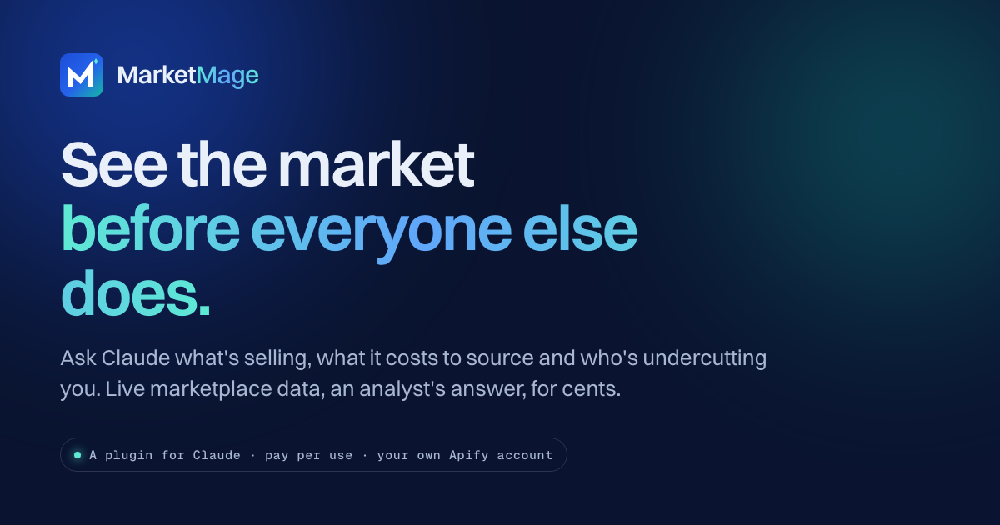

<p align="center">
  <a href="https://marketmage.io"></a>
</p>

<p align="center">
  <strong>An e-commerce analyst, inside Claude.</strong><br>
  Ask what's selling, what it costs to source, who's undercutting you and what your rivals are up to.<br>
  Claude reads the live marketplaces for your question and answers with the evidence and what to do next.
</p>

<p align="center">
  <a href="https://marketmage.io">Website</a> ·
  <a href="https://github.com/MarketMage/plugin">Plugin</a> ·
  <a href="https://marketmage.io/start/">Getting started</a> ·
  <a href="mailto:support@marketmage.io">Support</a>
</p>

---

### What you can ask

| | |
|---|---|
| **Find something to sell** | "I'm new, help me find something to sell" |
| **Check an idea** | "Is a heated eye mask worth selling for me?" |
| **Watch a competitor** | "What is allbirds.com selling right now?" |
| **Track what changes** | Prices, stock, ranks, reviews, promotions and new ads, in a weekly briefing |

Amazon, eBay, Etsy, Walmart, Target, TikTok Shop, Shopify stores, ad libraries, suppliers and Google Trends, in one conversation.

### How it works

- **Live data for your question.** Every answer is read fresh from the marketplaces when you ask.
- **You see every cost first.** Claude shows what a run costs before it starts, and every run carries a spending cap.
- **Your data stays in your account.** Results live in your own Apify account. All you provide is your Apify sign-in.

### Install in Claude Code

```
/plugin marketplace add MarketMage/plugin
/plugin install marketmage@marketmage
```

Then type `/marketmage:start` for a guided first session. Plugins are available on Claude's paid plans.

---

<sub>MarketMage is made by Extoris LLC. Security reports: <a href="mailto:security@marketmage.io">security@marketmage.io</a>.</sub>
